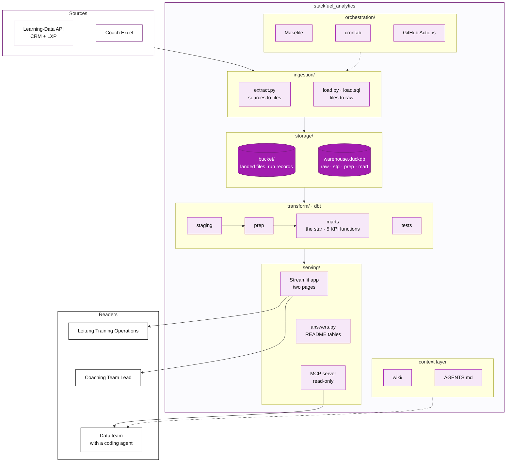
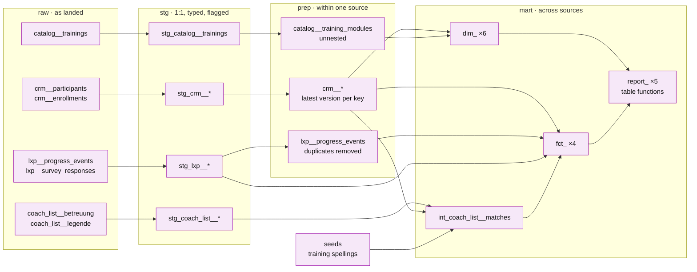
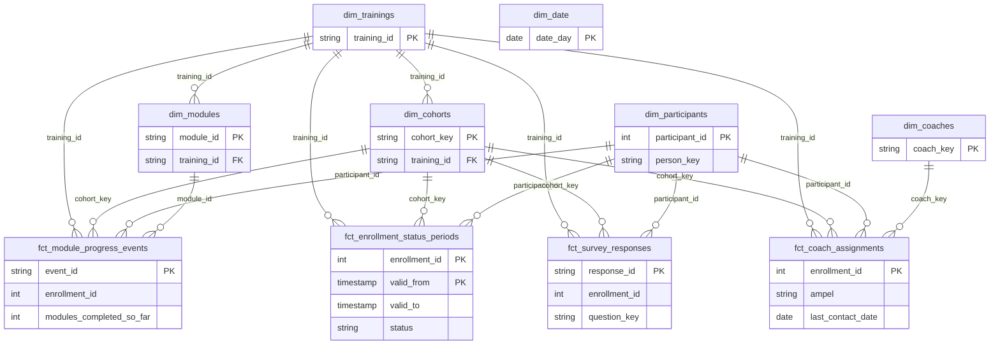
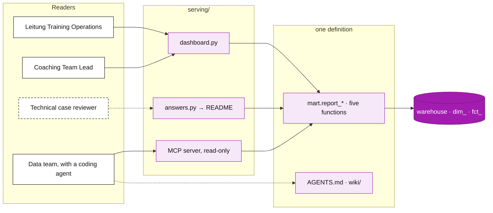
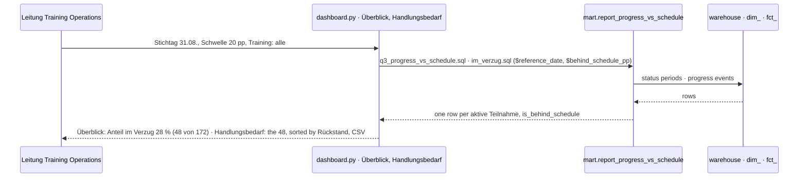
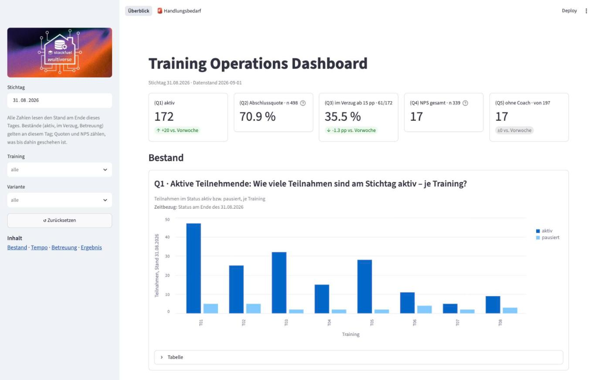
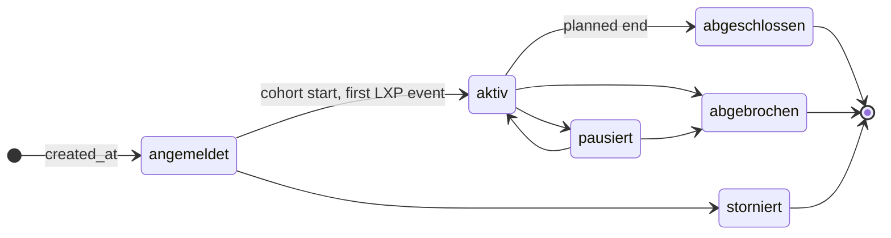
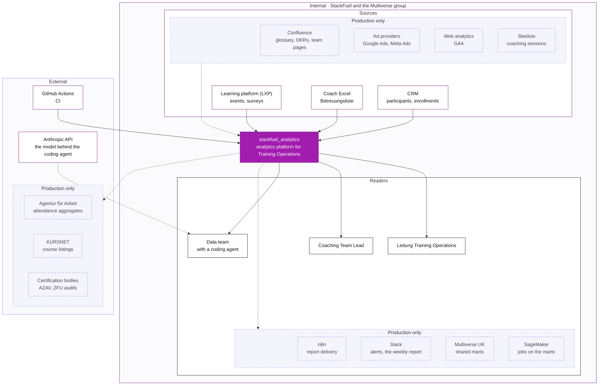

# stackfuel_analytics

## tl;dr

Weekly KPIs for Training Operations, as of **Stichtag 31.08.2026**, built from the CRM, the learning platform and the Betreuungsliste. `make run` builds the warehouse; `make answers` writes the five result tables and `make dashboard` opens the dashboard.


| KPI                             | At the Stichtag                                                                 | What to do                                             |
| ------------------------------- | ------------------------------------------------------------------------------- | ------------------------------------------------------ |
| **Aktive Teilnahmen**           | 172 aktiv, 25 pausiert                                                          | plan coach capacity on T01, T03 and T05                |
| **Abschluss- und Abbruchquote** | of 498 past their planned end: 71 % abgeschlossen, 18 % abgebrochen, 11 % offen | close or extend the 57 overdue, record the exit reason |
| **Im Verzug**                   | 61 of 172 (35 %) at least 15 pp behind plan                                     | work the Im-Verzug list weekly, T03 and T07 first      |
| **NPS**                         | 17 over all 339 answers, 26 over completers                                     | decide whether dropouts count; look at T04 either way  |
| **Coach-Auslastung**            | six coaches with 26 to 32 each, 31 on rot, 17 ohne Coach                        | assign the 17, clean the 251 flagged lines             |


**Behind the numbers:** give the Betreuungsliste a proper history and field validation, and date every status change in the CRM. Both are not much effort and remove a lot of the data quality issues this repository tries to clean.

## Setup and the one command

```bash
curl -LsSf https://astral.sh/uv/install.sh | sh   # once, if uv is missing
make run
```

`make dashboard` opens the dashboard on the built warehouse. Port 8000 taken? `make run API_BASE_URL=http://127.0.0.1:8001`.

`make run` brings everything else: Python 3.12, the pinned packages, the fixture API and its credentials.
A run should take well under a minute.
Every other command and the editor setup: [AGENTS.md](AGENTS.md).

## Architecture and data model

### Overview

This project closely follows the [Data Engineering Lifecycle](https://www.oreilly.com/library/view/fundamentals-of-data/9781098108298/ch02.html): Sources → ingestion → storage → transform → serving is the data's path; orchestration drives it.




Solid arrows carry data; dotted arrows drive or inform · purple = the system.

```
_brief/                   what StackFuel sent, untouched

.cursor/                  mcp.json: the warehouse MCP server, for Cursor
.github/                  CI workflow, pull-request template
.vscode/                  recommended extensions, settings
orchestration/
  crontab                 the daily run, one line
  README.md               the ladder from cron to an orchestrator
ingestion/
  sources.yaml            per source config
  extract.py              sources → files
  load.py · load.sql      files → raw
storage/                  built, never committed
  bucket/                 landed files, watermarks, run records
  warehouse.duckdb        raw · stg · prep · mart
transform/                dbt project
  README.md               layers, naming, test rules
  models/
    staging/              1:1 with raw: types, timezone, flags
    prep/                 within one source: latest version, dedup, unnest
    marts/                the star (dim_, fct_), the coach match (int_)
      training_operations/  the five KPI functions (report_)
  seeds/                  hand-kept mappings
  tests/                  singular tests: contract, pinned, finding
serving/
  dashboard.py            Streamlit, two pages
  answers.py              the five answers, printed and as CSV
  questions/              one query and its CSV per question
  worklists/              the Coaching Team Lead's lists
  agent_demo.md           a coding agent answering through the MCP server
  assets/                 the images and screenshot for the dashboard
wiki/                     the company-wiki stand-in: glossary, OKRs, roles

.mcp.json                 the warehouse MCP server, for Claude Code
AGENTS.md                 where an agent reads first: commands, rules
Makefile                  make run is the pipeline
pyproject.toml · uv.lock  Python 3.12, pinned packages
README.md                 this file
```


### Ingestion

- **The client** (`ApiClient` in `extract.py`) handles what the API throws:
  - a bearer token that expires after 60 minutes: re-login on 401 (implemented, not exercised; a run takes seconds)
  - `next_token` pages at the maximum page size
  - 503 with `Retry-After`, up to five retries
- **Incremental and idempotent.**
  - CRM and LXP are fetched from a watermark, the newest timestamp the source delivered last time.
  - Each fetch lands as files in `storage/bucket/`, never appended or deleted: the bucket keeps every version of a record.
  - `load.py` rebuilds `raw` from all files on every run; a second run lands nothing new and rebuilds the same tables.
- **Every run leaves a record** in `raw.load_history`: files, pages, rows, retries, watermark before and after.
- **Known limit.** The CRM watermark relies on `modified_at`, which can lag a status change (§ Data-quality findings).


### Storage

- **Bucket** `storage/bucket/`: every fetched file as landed, one folder per source table. The history.
- **Warehouse** `storage/warehouse.duckdb`: one file, one schema per layer (`raw`, `stg`, `prep`, `mart`, `seeds`). DuckDB allows one writer or many readers: the dashboard and the agent open it read-only.


### Transform

Conventions, naming and test rules: [transform/README.md](transform/README.md).




Not drawn: two dims read staging directly, and the facts and the coach match read the dims; the full lineage is the dbt extension's.

#### The star


| Process           | Fact                            | One row is                                                        | Answers                             |
| ----------------- | ------------------------------- | ----------------------------------------------------------------- | ----------------------------------- |
| enrollment status | `fct_enrollment_status_periods` | an enrollment in one status period, `valid_from` ≤ t < `valid_to` | Q1, Q2, the population of Q3 and Q5 |
| module progress   | `fct_module_progress_events`    | one LXP event, with running counts per enrollment                 | Q3                                  |
| survey response   | `fct_survey_responses`          | one question of one submission; an empty answer stays, as null    | Q4                                  |
| coach caseload    | `fct_coach_assignments`         | one enrollment on the coach list, with its counted line           | Q5                                  |


Six conformed dimensions sit under every fact. `enrollment_id` is the shared grain key (a Teilnahme
is participant × training, so it has no dimension of its own); `dim_date` joins on whichever date a
question needs.




#### The five KPI functions

- **One function per question**, a dbt model materialised as a table function in `mart` ([transform/models/marts/training_operations/](transform/models/marts/training_operations/)). Arguments: `reference_date` (default 31.08.2026) and, for Q3, `behind_schedule_pp` (default 15).
- **Counts, not rates**, at the question's grain; the caller sums and divides.
- **Four callers**: the answers, the dashboard, the pinned tests, the agent. One definition; a change is one file.

```sql
select * from mart.report_progress_vs_schedule()                       -- the weekly standard report
select * from mart.report_progress_vs_schedule(date '2026-06-30', 20)  -- another Stichtag, 20 pp
```


#### Tests and checks

Three kinds, every test tagged:

- **contract**: keys, no overlapping status periods. An error.
- **pinned**: a KPI reading at the Stichtag. After a live edit, `tag:pinned` shows what moved.
- **finding**: one tolerated defect each, with a ceiling; the registry is § Data-quality findings.

Two rules:

- a number in a test is a ceiling or a pin, never today's count
- failing rows land in `dbt_test__audit.<test name>` for the next reader

A new finding follows the decision tree in [transform/README.md § Tests](transform/README.md#tests).

### Serving

Every reader gets the five answers through one definition, the functions in `mart`: the Leitung and the Coaching Team Lead through the dashboard, the data team's coding agent through the MCP server, a reviewer through the queries in `serving/questions/` and their CSVs (§ Results).







#### Dashboard



Streamlit (`serving/dashboard.py`) on the built warehouse, read-only. Two pages:

- **Überblick**, for the Leitung: five cards, then the five questions, each with chart and table.
- **🚨 Handlungsbedarf**, for the Coaching Team Lead: the three work lists (Im Verzug, Ohne Coach, Betreuungsliste bereinigen), a CSV each.

Three rules:

- **One date.** The Stichtag is the state at the end of that day; every block names it.
- **Controls where they act.** The sidebar holds what applies everywhere (Stichtag, Training, Variante); thresholds and quarters sit in their block.
- **n beside every rate.** Under 10 answers a rate fades; colour marks the decision columns only.


#### Agent access

`.mcp.json` (Claude Code) and `.cursor/mcp.json` (Cursor), the same block twice, start the [MotherDuck MCP server](https://github.com/motherduckdb/mcp-server-motherduck) on the warehouse, read-only, one connection per query, pinned:

```json
{"mcpServers": {"warehouse": {"command": "uvx",
  "args": ["mcp-server-motherduck@1.1.0", "--db-path", "storage/warehouse.duckdb"]}}}
```

`AGENTS.md` tells the agent that a KPI is a call of `mart.report_*`, not a query over the star; asked for the Teilnahmen im Verzug at 20 Prozentpunkten, it returns the same 48 of 172 the dashboard shows ([serving/agent_demo.md](serving/agent_demo.md)). Serving is moving out of dashboards and into agents; one definition in the warehouse is what makes that safe.

### Orchestration

- `orchestration/crontab`: one line, 06:00, `make run`, stdout and stderr to a dated log. A failure is a non-zero exit; every run leaves its record in `raw.load_history`.
- CI (`.github/workflows/ci.yml`) is the second schedule: on every push a clean, pinned runner lints and runs the pipeline twice, comparing every table's row count. The fresh-machine test and the no-duplicates proof, in 58 s.


## Assumptions and definitions

### Overview
**Stichtag 31.08.2026**, the last second of the day. **Datenstand 01.09.2026**, the newest source timestamp. Berlin time throughout.

The scope is the Brief's: the scenario as presented and the five questions as written. In the room I would first ask how the five relate to the team's objectives and push back on two definitions before building. Every fork below is a decision taken, with the question I would bring to Training Operations and what hangs on it. Italics mark the Brief's words that needed a decision; bold marks the decision.

### The five questions


| #                | Brief, verbatim                                                                                                                                                                                                                                                                  | Interpretation                                                                                                                                                                                                                                                                                                                                                                           | Would ask Training Operations                                                                                                                                                  |
| ---------------- | -------------------------------------------------------------------------------------------------------------------------------------------------------------------------------------------------------------------------------------------------------------------------------- | ---------------------------------------------------------------------------------------------------------------------------------------------------------------------------------------------------------------------------------------------------------------------------------------------------------------------------------------------------------------------------------------- | ------------------------------------------------------------------------------------------------------------------------------------------------------------------------------ |
| **Q1 aktiv**     | Wie viele Teilnahmen sind am Stichtag *aktiv* – je Training?                                                                                                                                                                                                                     | • **aktiv = status aktiv at the end of the Stichtag**, from the status periods (§ Status at a date) • **pausiert counted beside it**, not inside                                                                                                                                                                                                                                         | Is aktiv the learner working now (progress events), or the funded participation (enrollment status)? (the funder's view would put paused people into Q3)                       |
| **Q2 Quoten**    | Für Teilnahmen, deren *geplantes Ende vor dem Stichtag* liegt: *Welcher Anteil* ist abgeschlossen, welcher abgebrochen – je Training und Förderart?                                                                                                                              | • planned end **strictly before** the Stichtag • **three shares adding to 100 %**: abgeschlossen, abgebrochen, offen (still aktiv, pausiert or angemeldet past the plan) • **Storno is not a dropout**: outside n • Förderart from the participant record; missing reads unbekannt                                                                                                       | Is a Storno a dropout? (moves the dropout rate) · How does the CRM record "left for a job" and "exam failed"? (both read abgebrochen today)                                    |
| **Q3 im Verzug** | Für *aktive* Teilnahmen: Wie weit sind die Teilnehmenden im Curriculum (*Anteil abgeschlossener Module*) im Vergleich dazu, wie viel der *geplanten Trainingsdauer bereits verstrichen* ist? Welcher Anteil liegt mindestens 15 Prozentpunkte hinter dem Zeitplan („im Verzug")? | • Q1's aktiv, **pausiert excluded** • learning = **completed modules ÷ the training's modules**; another training's module does not count • time = **calendar days since cohort start ÷ planned days**, held at 0 to 100 %, no pause deduction • im Verzug when time − learning ≥ **15 pp, a parameter** • per training **the share im Verzug is the answer**; the two means are context | Deduct paused weeks from elapsed time? (fewer im Verzug) · Is 15 pp the threshold the coaches act on? (at 20 pp: 48 instead of 61)                                             |
| **Q4 NPS**       | Wie hoch ist der Net Promoter Score (Promotoren 9–10 minus Detraktoren 0–6, in Prozent) aus dem *Abschlussfeedback* – je Training und *Quartal*?                                                                                                                                 | • the nps item of the Abschlussfeedback, submitted by the Stichtag; empty answers leave the base, "10/10" reads 10 • **quarter of submission**, Berlin time • **dropouts' answers count in the headline**; completer and dropout scores stand beside it                                                                                                                                  | Does a dropout's feedback count? (17 with, 26 without) · Quarter by feedback date or by training end? · A minimum n per cell?                                                  |
| **Q5 Coach**     | Wie viele *aktive oder pausierte* Teilnahmen betreut jeder Coach *laut Betreuungsliste*, und wie viele davon stehen auf *rot*? Wie viele Teilnahmen konntest du *keinem Coach zuordnen*?                                                                                         | • **the list is the authority** on coach and Ampel, as delivered (it has no history) • matched to the CRM by email, else by name (§ The coach match); **one counted line per Teilnahme**, the latest Letzter Kontakt • **"g" is not rot** • ohne Coach = aktiv or pausiert with no counted line, never forced onto a coach                                                               | Betreuungsliste or CRM as the authority on who coaches whom? (the 17 ohne Coach would change) · Who owns the Ampel's meaning and cadence? (31 rot, 36 if any rot line counted) |


Every other business rule the models encode (version rules, the cohort key, the Ampel parsing, the match ladder) sits in the model's header comment and in [transform/README.md](transform/README.md). The one assumption that touches every question follows.

### Status at a date

The CRM keeps only today's status, so `fct_enrollment_status_periods` rebuilds each enrollment's earlier periods from the evidence the sources leave, and every question reads the status at its date from them.

Six statuses; the CRM documents no transitions, so these are read from timing patterns:




Learning happens in aktiv only, so the first LXP event opens it; at most three periods per enrollment:

```
                            created_at     first LXP event    last status change     enrollments
finished or paused now      ├─ angemeldet ──┼────── aktiv ──────┼─ abgeschlossen ──►      503
aktiv now, changed later    ├─ angemeldet ──┼──── unbekannt ────┼─ aktiv ──────────►       56
aktiv since the start       ├─ angemeldet ──┤ aktiv ────────────────────────────────►      103
angemeldet or storniert     ├ angemeldet ───────────────────────────────────────────►       47
                               inferred          inferred             observed
```

- **The assumption:** aktiv between the first event and the last status change. A pause inside that span is not observable in one fetch.
- **Where it is not made:** 56 enrollments are aktiv today and changed after their start; the span reads `unbekannt`, and no question counts it.
- **The effect** against today's status: Q1 +13 aktiv, −3 pausiert · Q2 none · Q3 +13, none behind · Q4 −24 answers · Q5 +10. Pinned in `enrollment_status_as_of_stichtag`.
- **In production** the inference ends with the second daily run: the bucket keeps every CRM version.

Questions for Training Operations: can an enrollment return to angemeldet, or leave storniert or abgeschlossen (assumed not)? Does LXP activity count as aktiv while the CRM says angemeldet? Report inferred statuses, or observed only?

## Data-quality findings

Only the findings that needed a decision a reader could disagree with; counts in the delivered data at the Stichtag.

- **Tests:** each finding has one test in `transform/tests/`, tagged `finding`, with a ceiling; its failing rows sit in `dbt_test__audit` after each build.
- **Owner:** the department whose source holds the finding, with what I would ask of it.


| Impact           | Finding                                                                                                                                     | Rows                                                | Handling                                                                                                                  | Ask the owner                                                                    |
| ---------------- | ------------------------------------------------------------------------------------------------------------------------------------------- | --------------------------------------------------- | ------------------------------------------------------------------------------------------------------------------------- | -------------------------------------------------------------------------------- |
| 🔴 Q1, Q4        | Status changed between Stichtag and Datenstand (the 01.09 batch); 24 final-feedback answers from 01.09                                      | 14                                                  | status modelled as periods, read as of the end of 31.08 (§ Status at a date)                                              | Operations: record every status change with its date in the CRM                  |
| 🔴 Q3            | The same LXP event delivered twice                                                                                                          | 222 pairs                                           | the copy removed in prep                                                                                                  | Engineering: deduplicate at the export                                           |
| 🔴 Q4            | Empty NPS answers; values typed like "10/10"                                                                                                | 4 · 347                                             | empty → null and out of the base; "10/10" → 10, in staging                                                                | Engineering: validate the score field in the survey                              |
| 🔴 Q4            | Final feedback answered after a dropout, days after the drop; 24 of the 30 are detractors                                                   | 30 of 339                                           | kept; the respondent's status is a dimension, so the NPS reads over all answers (17) or completers (26)                   | Operations: is the exit survey meant for dropouts?                               |
| 🔴 Q5            | Coach list typed by hand: names in two orders, emails missing on a quarter of the lines, the training in 33 spellings, cohort as month only | 429 lines                                           | normalised in staging, flagged per line for the clean-up list; spellings mapped by a seed                                 | Delivery: a key and dropdowns in the list (§ Validation at the source)           |
| 🟡 Q2, Q5        | Enrollment without a participant in the CRM                                                                                                 | 6                                                   | kept, funding type "unbekannt"                                                                                            | Operations: restore the six participant records                                  |
| 🟡 Q2 offen      | Aktiv or pausiert long past the planned end                                                                                                 | 57                                                  | valid: overdue learners, reported as offen                                                                                | Operations: close or extend them                                                 |
| 🟡 Q1            | First LXP event or status change before the CRM record was created                                                                          | 8                                                   | kept; the inferred aktiv starts at the record, so up to two weeks of aktiv are not counted                                | Engineering: why does the platform admit a learner before the CRM record exists? |
| 🟡 Q5 ohne Coach | Teilnahme aktiv or pausiert with no line in the list                                                                                        | 17 of 197                                           | reported as ohne Coach, never forced onto a coach                                                                         | Delivery: enter the 14; 3 have no CRM record to match                            |
| 🟡 Q5 rot        | The same Teilnahme on two lines, the Ampel differs                                                                                          | 44                                                  | the line with the latest Letzter Kontakt counts: 31 rot, 36 if any rot line counted                                       | Delivery: one line per learner                                                   |
| ⚪                | Same person under two participant ids (same email, name, birth date)                                                                        | 18 people                                           | not merged; a person key names the person, KPIs count enrollments                                                         | Growth: a duplicate check on email at registration                               |
| ⚪                | Channel Jobcenter but funding Firmenkunde or Selbstzahler                                                                                   | 96                                                  | funding type trusted, it is the billing field                                                                             | Growth: is the channel "how they heard" or "who sent them"?                      |
| ⚪ Q1, Q2         | Status changed after the record's last modification                                                                                         | 2                                                   | kept; the watermark could miss such a change                                                                              | Engineering: does a status change touch modified_at?                             |
| ⚪ Q3             | A module's event under an enrollment of another training                                                                                    | 30                                                  | kept and flagged, skipped by the progress count                                                                           | Engineering: how does a learner complete another training's module?              |
| ⚪                | Participants without a birth date                                                                                                           | 22                                                  | kept; identity matching cannot use it                                                                                     | Growth: birth date required at intake                                            |
| ⚪ Q5             | Coach list Ampel empty, or "g" (grün or gelb)                                                                                               | 164 · 15                                            | not counted as rot; "g" flagged, not guessed                                                                              | Delivery: three values, filled at every contact                                  |
| ⚪ Q5             | Coach match: the list has no key                                                                                                            | 329 by email, 100 by name, 0 ambiguous, 0 unmatched | email + training, else name + cohort month + training (figure below); a line fitting two or none is flagged, never forced | Delivery: the participant id on every line                                       |
| ⚪ Q1, Q3         | Abgeschlossen stamped weeks before the planned end while events continue                                                                    | 8                                                   | kept as delivered; none of them aktiv at 31.08                                                                            | Operations: exam passed early, or a wrong stamp?                                 |


### The coach match

The list has no key, so each line looks for the enrollment it could mean:

```
sheet line ─┬─ email ──── email path: email + training ────────────────┐
            └─ no email ─ name path:  name + cohort month + training ──┴─► candidates

candidates per line:  1 → matched · 0 → unmatched · 2+ → ambiguous (never forced)
several lines matched to one enrollment: the latest Letzter Kontakt counts, the others are duplicates
```

The training comes from the spellings seed on both paths; names are compared lower case with umlauts spelled out. Result on the delivered list: 329 lines by email, 100 by name, none ambiguous or unmatched; 44 duplicate lines. Limits: a misspelt name, two people with the same name in one cohort, a training typed as another.

### Validation at the source

The table asks the owners for fields and keys; the Betreuungsliste the team can fix itself, in two tiers:

- **Tier 1, the Sheet:** Training and Ampel as dropdowns, Kohorte and Letzter Kontakt as dates, E-Mail validated or looked up from a CRM export by participant id, a duplicate highlight on the id, version history on. Stops the 33 spellings, "g", the two name orders, month-only cohorts and duplicate learners.
- **Tier 2, a form in front of it:** one entry per contact (id, Ampel, date, note), each a new line, the latest per learner counts. Gives the Ampel the history the CRM lacks too.

Tier 1 alone removes most of the potential issues and clean-up work; both keep the list in the team's hands.

## Results

**Stichtag 31.08.2026 · Datenstand 01.09.2026.** Three messages for the Leitung Training Operations:

- **The Bestand is steady, the tempo is not.** 172 aktiv, almost half in the two Vollzeit tracks T01 and T03. A third is at least 15 pp behind plan; time runs ahead of learning in every training, widest in T03 and T07. → Q1, Q3
- **Outcomes are healthy, the tail is not closed.** Seven in ten past their planned end finished, under a fifth dropped out; about one in ten is still open weeks past the plan, inflating "offen" and sitting in the funders' reports. → Q2
- **The NPS is two populations.** Completers are clearly positive, the dropouts who answered the exit survey strongly negative, the headline sits between. T04 is negative in every year; 2026 reads below 2025. → Q4

**Recommendations:**

- **Work the Im-Verzug list weekly**, T03 and T07 first (🚨 Handlungsbedarf, Q3).
- **Close or extend the overdue Teilnahmen**, and record the exit reason (Q2).
- **Decide whether dropouts' feedback counts in the NPS**; look at T04 either way (Q4).
- **Give the Betreuungsliste a key and a clean-up** (Q5, § Validation at the source).

The numbers: one query and its CSV per question in [serving/questions/](serving/questions/) (`make answers` rewrites them from the warehouse), the dashboard (§ Dashboard), or the one-line agent prompt (§ Agent access). Each answer below: the Brief's question, query and CSV, the answer in one line, the table at the Brief's grain, what it means, the decision.

**Q1 · Aktive Teilnehmende: Wie viele Teilnahmen sind am Stichtag aktiv – je Training?**

[q1_active_participations.sql](serving/questions/q1_active_participations.sql) · [CSV](serving/questions/q1_active_participations.csv) · **172 aktiv, 25 pausiert beside them.**


| training_id | training_name                                       | variant          | active | paused |
| ----------- | --------------------------------------------------- | ---------------- | ------ | ------ |
| T01         | Data Analyst – Vollzeit                             | vollzeit         | 47     | 5      |
| T02         | Data Analyst – Teilzeit                             | teilzeit         | 25     | 5      |
| T03         | Data Scientist – Vollzeit                           | vollzeit         | 32     | 2      |
| T04         | Data Scientist – Teilzeit                           | teilzeit         | 15     | 2      |
| T05         | Data Engineer – Vollzeit                            | vollzeit         | 28     | 2      |
| T06         | Python für Data Analytics – Berufsbegleitend        | berufsbegleitend | 11     | 4      |
| T07         | KI & Machine Learning Grundlagen – Berufsbegleitend | berufsbegleitend | 5      | 2      |
| T08         | Business Intelligence mit Power BI – Vollzeit       | vollzeit         | 9      | 3      |


What it means: the two Data Analyst and Data Scientist Vollzeit tracks are the business; T07's five aktiv make its 60 % im Verzug three people. Decision: read the small trainings' rates with their n, and plan coach capacity on T01, T03 and T05.

**Q2 · Abschluss- und Abbruchquote: Für Teilnahmen, deren geplantes Ende vor dem Stichtag liegt: Welcher Anteil ist abgeschlossen, welcher abgebrochen – je Training und Förderart?**

[q2_completion_rates.sql](serving/questions/q2_completion_rates.sql) · [CSV](serving/questions/q2_completion_rates.csv) · **Of 498: 71 % abgeschlossen, 18 % abgebrochen, 11 % offen; no Storno in the window.** Per training and funding type, 27 cells, in the CSV; summed per training here:


| training_id | training_name                                       | n   | completed | dropped_out | still_open | completion_rate_pct | dropout_rate_pct | open_rate_pct |
| ----------- | --------------------------------------------------- | --- | --------- | ----------- | ---------- | ------------------- | ---------------- | ------------- |
| T01         | Data Analyst – Vollzeit                             | 130 | 87        | 26          | 17         | 66.9                | 20.0             | 13.1          |
| T02         | Data Analyst – Teilzeit                             | 52  | 36        | 9           | 7          | 69.2                | 17.3             | 13.5          |
| T03         | Data Scientist – Vollzeit                           | 92  | 63        | 19          | 10         | 68.5                | 20.7             | 10.9          |
| T04         | Data Scientist – Teilzeit                           | 23  | 19        | 3           | 1          | 82.6                | 13.0             | 4.3           |
| T05         | Data Engineer – Vollzeit                            | 56  | 41        | 10          | 5          | 73.2                | 17.9             | 8.9           |
| T06         | Python für Data Analytics – Berufsbegleitend        | 50  | 36        | 8           | 6          | 72.0                | 16.0             | 12.0          |
| T07         | KI & Machine Learning Grundlagen – Berufsbegleitend | 29  | 23        | 3           | 3          | 79.3                | 10.3             | 10.3          |
| T08         | Business Intelligence mit Power BI – Vollzeit       | 66  | 48        | 10          | 8          | 72.7                | 15.2             | 12.1          |


By funding type: Bildungsgutschein 72 % completion (n 347), Selbstzahler 69 % (73), Firmenkunde 67 % (75) with 16 % still open. What it means: completion differs little by training or funder; the open share does, highest for Firmenkunden (16 %). Decision: close or extend every Teilnahme past its planned end, and record the exit reason, so a dropout and a failed exam stop looking alike.

**Q3 · Lernfortschritt vs. Zeitfortschritt: Für aktive Teilnahmen: Wie weit sind die Teilnehmenden im Curriculum im Vergleich dazu, wie viel der geplanten Trainingsdauer bereits verstrichen ist? Welcher Anteil liegt mindestens 15 Prozentpunkte hinter dem Zeitplan („im Verzug")?**

[q3_progress_vs_schedule.sql](serving/questions/q3_progress_vs_schedule.sql) · [CSV](serving/questions/q3_progress_vs_schedule.csv) · **61 of 172 im Verzug (35 %) at 15 pp.** Per training the mean learning and time progress over its Teilnahmen, each weighing one, and the share behind; no total across trainings.


| training_id | training_name                                       | variant          | n   | modules_completed_pct | time_elapsed_within_plan_pct | behind_schedule | behind_schedule_pct |
| ----------- | --------------------------------------------------- | ---------------- | --- | --------------------- | ---------------------------- | --------------- | ------------------- |
| T01         | Data Analyst – Vollzeit                             | vollzeit         | 47  | 47.9                  | 57.4                         | 17              | 36.2                |
| T02         | Data Analyst – Teilzeit                             | teilzeit         | 25  | 30.0                  | 35.0                         | 8               | 32.0                |
| T03         | Data Scientist – Vollzeit                           | vollzeit         | 32  | 48.4                  | 60.0                         | 14              | 43.8                |
| T04         | Data Scientist – Teilzeit                           | teilzeit         | 15  | 46.7                  | 49.3                         | 3               | 20.0                |
| T05         | Data Engineer – Vollzeit                            | vollzeit         | 28  | 47.6                  | 56.4                         | 9               | 32.1                |
| T06         | Python für Data Analytics – Berufsbegleitend        | berufsbegleitend | 11  | 54.5                  | 59.1                         | 3               | 27.3                |
| T07         | KI & Machine Learning Grundlagen – Berufsbegleitend | berufsbegleitend | 5   | 28.0                  | 40.0                         | 3               | 60.0                |
| T08         | Business Intelligence mit Power BI – Vollzeit       | vollzeit         | 9   | 63.0                  | 72.2                         | 4               | 44.4                |


What it means: in every training time runs ahead of learning, by 3 pp (T04) to 12 pp (T07, T03); the share behind is highest where the gap is widest. The threshold is a parameter: at 20 pp the share is 28 % (48). Decision: a weekly pass over the Im-Verzug list, T03 and T07 first; agree the threshold with the coaches, and whether paused weeks should count.

**Q4 · NPS: Wie hoch ist der Net Promoter Score (Promotoren 9–10 minus Detraktoren 0–6, in Prozent) aus dem Abschlussfeedback – je Training und Quartal?**

[q4_nps_by_quarter.sql](serving/questions/q4_nps_by_quarter.sql) · [CSV](serving/questions/q4_nps_by_quarter.csv) · **17 over all 339 answers; 26 over completers alone.** Per training and quarter of submission, 60 cells, in the CSV; summed per training here:


| training_id | training_name                                       | n   | nps | n_completed | nps_completed | n_dropped_out |
| ----------- | --------------------------------------------------- | --- | --- | ----------- | ------------- | ------------- |
| T01         | Data Analyst – Vollzeit                             | 79  | 32  | 74          | 40            | 5             |
| T02         | Data Analyst – Teilzeit                             | 37  | 19  | 33          | 27            | 4             |
| T03         | Data Scientist – Vollzeit                           | 59  | 8   | 53          | 19            | 6             |
| T04         | Data Scientist – Teilzeit                           | 21  | -38 | 18          | -28           | 3             |
| T05         | Data Engineer – Vollzeit                            | 42  | 31  | 36          | 50            | 6             |
| T06         | Python für Data Analytics – Berufsbegleitend        | 35  | 34  | 32          | 41            | 3             |
| T07         | KI & Machine Learning Grundlagen – Berufsbegleitend | 25  | -8  | 23          | 0             | 2             |
| T08         | Business Intelligence mit Power BI – Vollzeit       | 41  | 10  | 40          | 10            | 1             |


What it means: the headline is dragged by the 30 dropouts who answered the exit survey, 24 of them detractors (−77 as a group). Completers alone read 19 to 50 in six trainings; T04 is negative on both counts and T07 is at zero. 2026 so far reads 13 against 21 in 2025. Decision: decide whether the exit survey is meant for dropouts, and report both scores until then; talk to T04's cohorts before the next quarter closes.

**Q5 · Coach-Auslastung: Wie viele aktive oder pausierte Teilnahmen betreut jeder Coach laut Betreuungsliste, und wie viele davon stehen auf rot? Wie viele Teilnahmen konntest du keinem Coach zuordnen?**

[q5_coach_load.sql](serving/questions/q5_coach_load.sql) · [CSV](serving/questions/q5_coach_load.csv) · **Six coaches carry 26 to 32 Teilnahmen each, 31 on rot; 17 Teilnahmen have no coach in the list.**


| coach_name     | enrollments | green | yellow | red | ampel_missing |
| -------------- | ----------- | ----- | ------ | --- | ------------- |
| Daniel Brandt  | 31          | 15    | 5      | 7   | 4             |
| Elif Kaya      | 26          | 11    | 6      | 7   | 2             |
| Jonas Petersen | 31          | 15    | 8      | 5   | 3             |
| Miriam Vogt    | 29          | 17    | 5      | 3   | 4             |
| Sarah Kowalski | 32          | 17    | 11     | 2   | 2             |
| Tobias Lindner | 31          | 13    | 6      | 7   | 5             |
| ohne Coach     | 17          |       |        |     |               |


What it means: the load is even; the signal is not. 20 of the 180 counted lines have no usable Ampel, 44 Teilnahmen stand on two lines with different colours, and the list has no history, so "rot" cannot be trended. Decision: assign the 17, clean the 251 flagged lines, and give the list a key and a history (§ Validation at the source) before the Ampel becomes a KPI.

### The work lists

Three lists turn the answers into the week's work: each names the Teilnahmen to act on, sorted, as a CSV from the 🚨 Handlungsbedarf page; the SQL in [serving/worklists/](serving/worklists/).


| List                       | Rows | Description                                                                                                                                 |
| -------------------------- | ---- | ------------------------------------------------------------------------------------------------------------------------------------------- |
| Im Verzug                  | 61   | for each coach: the learners to contact, sorted by Rückstand; the threshold is theirs to set                                                |
| Ohne Coach                 | 17   | for the Coaching Team Lead: assign a coach or enter the missing line; 3 have no CRM record and need Operations first                        |
| Betreuungsliste bereinigen | 251  | for the Coaching Team Lead: the flagged lines to correct (missing email, reversed name, month-only cohort, ambiguous Ampel, duplicate line) |


## AI use

AI did most of the typing and none of the deciding. Every line of this repository has been read by me and can be changed live; every number was checked against an independent query before it was pinned.

**For what**

- **Planning:** the spec, the build order, the split into parallel workstreams per stage.
- **Tool choices:** web research on candidates, then installing and measuring them (image size, run time, whether a tool holds the DuckDB lock).
- **First drafts of every file**, loader to dashboard to these pages. The agent runs what it writes, reads its own screenshots, fixes what it sees.
- **Data profiling:** the counts behind every finding, each re-run before it entered the table.
- **Once, offline:** the spelling seed (33 coach-list spellings to the catalog), checked in as a CSV and read line by line.

**How**

- **Spec first, conventions as context.** Folder layout, layers, naming and test rules from the data platform I built before this one; the one-pager's diagrams, landscape and team goals went into the context before the first file. `wiki/` (glossary, OKRs, roles) keeps that durable, so the agent optimises for what Training Operations needs, not for the five questions alone.
- **Thought partner, not executor.** Interview mode: it asks, lays options side by side, names trade-offs; I decide, one decision per step, the rejected alternative logged. Most input was spoken; the agent structures it into a spec.
- **Parallel sessions, one coordinator** owning the shared files and rulings. Heavy reasoning models for design and review, lighter ones for mechanical passes.
- **A leash of two lengths.** Loose on scaffolding (`pyproject.toml`, Makefile, the API client: little attention, replaced in production). Tight on `transform/`: definitions, status periods, coach match; every line read, every number re-derived by a fresh query on the lower layers, then pinned.
- **Vocabulary is the work.** Much of the dialogue was domain modelling: the right word for a period, a line, a match; column names that read as the definition. The SQL needs fewer comments.

**Learnings**

- **The dumb zone.** Past a quarter to a third of the context window answers degrade: repeats, dropped constraints, fast agreement. A fresh window per session, compacted before that point.
- **Eager to build.** Left alone it implements: dbt snapshots as the history (fed no model, broke on several versions per key; removed, the landed files are the history), the newest dbt Fusion (outside the lock file, no DuckDB extensions; pinned dbt-core 1.12).
- **Plausible tests and comments.** It tests what the SQL makes true by construction and writes headers that restate the model. The three test kinds and the no-tautologies rule came from pruning that.
- **Fluent mechanism, unmarked premise.** It built the status-period inference without naming "aktiv between first event and last change" as an assumption. Naming it, measuring what rests on it, writing the production exit: mine. The general pattern.
- **Overfits the question.** It optimises for the five questions as written and resists the Leitung's Monday view. Wiki and interview mode are the counterweights; the reading in § Results is mine.

In production the loop grows longer: the analytics engineer's responsibilities and interfaces defined up front (definitions, contracts, review), so an agent can run the mechanical part inside a frame it did not set.

## Wenn das produktiv laufen sollte

The shape stays: every folder maps to one production piece, and the models, tests and five functions move as they are. 🔴 first week · 🟡 first quarter · ⚪ on a trigger.


| Stage         | Today                                                         | Production                                                                                                                                                                                                                                                                                                                                                                                                                                                                                                                                                                        |     |
| ------------- | ------------------------------------------------------------- | --------------------------------------------------------------------------------------------------------------------------------------------------------------------------------------------------------------------------------------------------------------------------------------------------------------------------------------------------------------------------------------------------------------------------------------------------------------------------------------------------------------------------------------------------------------------------------- | --- |
| Ingestion     | `extract.py` to files; watermarks; the fixture API            | • a connector per real source (Airbyte first, dlt the alternative); until then only the `api:` block in `sources.yaml` changes • a periodic full CRM pull beside the watermark closes the `modified_at` gap • **Monitoring** at the source: freshness per table, numbers by Monday 07:00                                                                                                                                                                                                                                                                                          | 🔴  |
| Storage       | `storage/bucket/` + one DuckDB file, a schema per layer       | • S3 with versioning, never wiped: from the second daily run the bucket is the status history and the inference of § Status at a date ends • Snowflake: a database per layer, a warehouse each for loading, transforming and reporting, a role per stage • **Datenschutz**: the reporting role and the agent see no personal data (email and birth date masked, names only for the coaching role); a retention period and an erasure path per participant; open and named: a never-wiped bucket against DSGVO Art. 17, and the transfer basis before marts are shared with the UK | 🔴  |
| Transform     | dbt on DuckDB; three test kinds; findings owned by dbt groups | • the same models on Snowflake • **Tests**: results as data, alerts to the owning department (Elementary); the groups become the catalog's owners • a versions model over the landed CRM files replaces inference with observed periods                                                                                                                                                                                                                                                                                                                                           | 🟡  |
| Serving       | Streamlit, the answers, a read-only MCP server                | • the five functions become a Snowflake Semantic View, or stay table functions one to one • Metabase on it: a native question per query with `{{reference_date}}`, the two pages become two dashboards; the weekly report delivered to Slack, not opened • agents reach the same object through Metabase's MCP server or Cortex Analyst                                                                                                                                                                                                                                           | 🟡  |
| Orchestration | `make run` by cron; CI on GitHub Actions                      | • **Orchestrierung**: a scheduler runs the pipeline image as a container task; logs and retries by the platform • an orchestrator (Dagster, Prefect, MWAA) when a second dependent pipeline, a second person on call or routine backfills arrive ([orchestration/README.md](orchestration/README.md)) • **Monitoring** of the run: a non-zero exit to Slack, the run records as data (`raw.load_history`), an alarm when the schedule did not fire                                                                                                                              | 🟡  |


The landscape it lands in. Solid is this repository; dashed is production only.




### Undercurrents

What runs under every stage, in the lifecycle's own categories:


| Undercurrent         | Today                                                                         | Production                                                                                                                                                                                                                                                                                       |     |
| -------------------- | ----------------------------------------------------------------------------- | ------------------------------------------------------------------------------------------------------------------------------------------------------------------------------------------------------------------------------------------------------------------------------------------------ | --- |
| Security             | the fixture's credentials as Makefile defaults; one file, no roles                                         | • credentials in AWS Secrets Manager • a role per stage: the loader writes raw, the transformer reads raw and writes the rest, the reporter reads marts • personal data masked for reporting and agents                                                                                            | 🔴  |
| Data management      | the findings table as registry; dbt groups as owners; `wiki/` as glossary     | • the groups become catalog owners, each finding routed to its department • personal data inventoried once; retention and erasure per participant • the glossary and OKRs in the company wiki, read by people and agents                                                                         | 🟡  |
| DataOps              | CI lints and runs the pipeline twice on every push; the PR template           | • CI as a merge gate (branch protection) that builds the one versioned image the scheduler runs • test results as data and alerts (Elementary) • dev and prod differ by one variable                                                                                                             | 🔴  |
| Data architecture    | every folder one production piece; a schema per layer; everything pinned      | • infrastructure as code: every resource replaces one thing in this repository (bucket, secret, schedule, task, log group; databases, warehouses, roles), nothing speculative • left out and named: network, image build, users and key pairs; the group's modules replace the blocks one by one | ⚪   |
| Software engineering | ruff, sqlfluff; the model template; three test kinds; the no-tautologies rule | • the same conventions enforced in CI • CODEOWNERS by dbt group • a translation column per German categorical when the first English-speaking reader joins                                                                                                                                       | ⚪   |


### The three moves

The three I proposed before seeing the data; the case confirms the order.


| Move                | In this repository                                                                    | In production                                                                | Returns                                                                                                                              |
| ------------------- | ------------------------------------------------------------------------------------- | ---------------------------------------------------------------------------- | ------------------------------------------------------------------------------------------------------------------------------------ |
| **1 · Foundation**  | files first, a schema per layer, everything pinned, CI on every push                  | S3 and Snowflake, a role per stage, one image, one variable for dev and prod | no unnecessary rework as the team grows; engineering time focused on definitions and serving, not on moving data; personal data masked |
| **2 · Definitions** | five functions, one definition for four consumers, pinned tests, findings with owners | the same models, a semantic view, alerts to the owners                       | a single source of truth: each question’s number is clear in every report and dashboard; no ambiguity in reporting                   |
| **3 · Serving**     | the dashboard, the work lists, a read-only agent                                      | Metabase, its MCP server, delivery to Slack                                  | answers are delivered to where questions originate; timely information gets to the relevant person                                    |